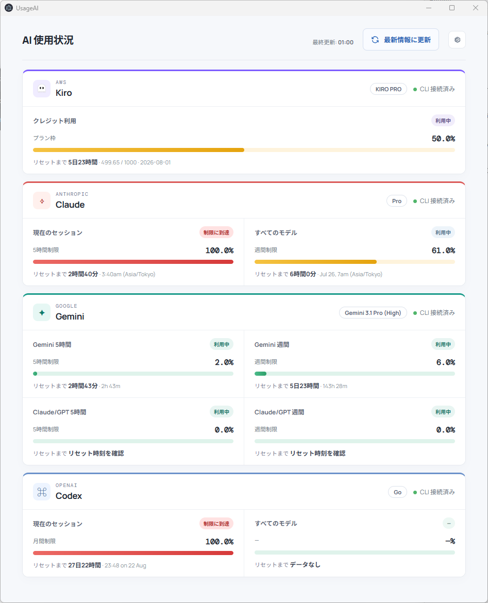

# UsageAI (AI Usage Dashboard)

複数のAIモデル（Claude、Gemini、AWS、OpenAIなど）の使用状況を一括で確認できる、**Windows向け**ダッシュボードアプリです。Electronを使用して構築されています。

## 画面イメージ (Screenshot)



## 特徴 (Features)
- **Windowsネイティブ対応**: Windows環境での利用に最適化されたポータブル版ビルドを提供。
- **複数AIの一括管理**: 各種AIベンダーの使用状況（現在のセッション制限、週間制限、リセットまでの時間など）を1つの画面で確認できます。
- **カスタマイズ可能な表示**: 右上の設定アイコンから、表示するAIベンダーのオン/オフや、表示順序を自由に変更できます。

## 対応しているAI (Supported AIs)
現在、以下のAIプロバイダーのCLIツールに対応しています。
- **Anthropic (Claude Code)**
- **Google (Antigravity CLI / agy)**
- **OpenAI (Codex)**
- **AWS (Kiro CLI)**

## 前提条件 (Prerequisites)
このアプリは、各AIが提供する**CLI（コマンドラインツール）**の出力結果を裏側で実行・解析して情報を表示しています。そのため、以下の準備が必須となります。

1. **CLIツールのインストール**: 使用したいAIの公式CLIツールがPCにインストールされていること。
2. **アカウントのログイン（認証）済み**: 各CLIツール上で、ご自身のアカウントにログインが完了しており、ターミナルからコマンドを実行すれば使用状況が取得できる状態であること。

> **💡 CLIのインストール場所について**
> 本アプリは、各CLIの標準的なインストール先（`%LOCALAPPDATA%` や `%APPDATA%`など）を自動的に検索します。
> 別のドライブや独自のツール経由でカスタムインストールしている場合でも、Windowsの**環境変数 `PATH` が通っていれば自動的に認識して起動**できる仕組みになっています。うまく取得できない場合は、CLIへのPATHが通っているか確認してください。

> ※ CLIがインストールされていない、またはログイン期限が切れている場合は、アプリ上で正しくデータを取得できません。

## ⚠️ 注意事項・制限事項 (Limitations & Warnings)
- **CLIのアップデートによる影響**: 
  本アプリは各CLIが出力するテキスト（フォーマット）に依存しています。そのため、将来的にAIプロバイダー側で**CLIがバージョンアップされ、出力されるテキストの形式が変更された場合、アプリ側でデータを正しく読み取れなくなり、表示がエラーになる可能性**があります。
  （※ その場合はアプリ側（解析ロジック）の修正アップデートが必要になります）

## 使い方 (Usage)
1. アプリを起動すると、各AIの使用状況が一覧表示されます。
2. 情報を手動で更新したい場合は、右上の**「最新情報に更新」**ボタンをクリックします。
3. 右上の**「設定（歯車アイコン）」**をクリックすると設定画面が開き、表示するAIの絞り込みや並び替えが行えます。

## トラブルシューティング (Troubleshooting)
* **「情報が取得できない」「CLI未接続と出る」場合:**
  まずはコマンドプロンプトやPowerShellを単体で開き、該当AIのCLIコマンドを手動で実行してみてください。ログイン期限が切れていたり、再認証が求められている場合があります。

## インストールと起動 (Installation & Setup)

1. 依存パッケージをインストールします。
   ```bash
   npm install
   ```
2. アプリケーションを開発モードで起動します。
   ```bash
   npm start
   ```

## ビルド (Build)

Windows向けのポータブル実行ファイル（`.exe`）を作成するには、以下のコマンドを実行します。
ビルドされたファイルは `release/` フォルダに出力されます。

```bash
npm run build:win
```

## プロジェクト構成 (Project Structure)
- `main.js`: Electronのメインプロセス（バックグラウンド処理・CLIコマンドの実行）
- `renderer.js`: UIなどを制御するレンダラープロセス
- `preload.js`: メインとレンダラーを安全に繋ぐブリッジ
- `index.html`: アプリケーションのメイン画面
- `styles.css`: デザイン・スタイルシート
